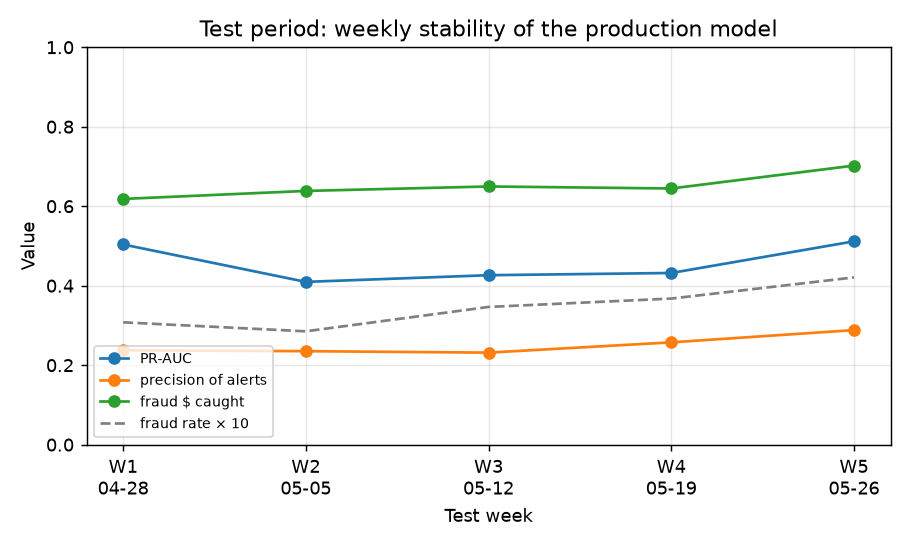
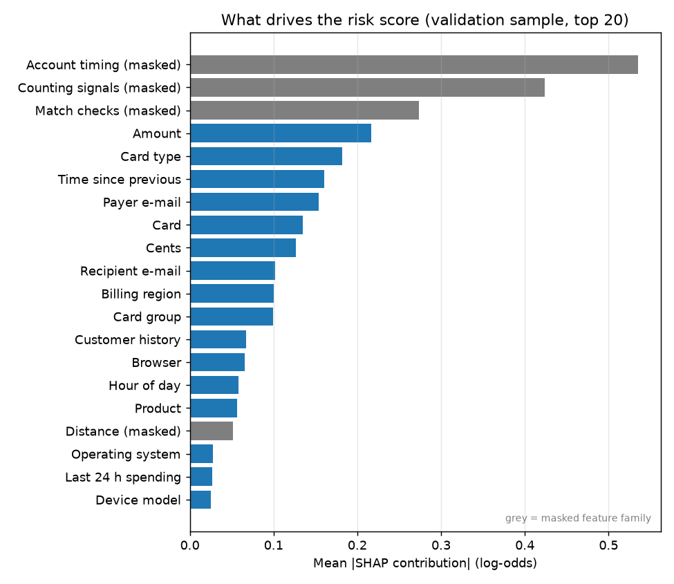
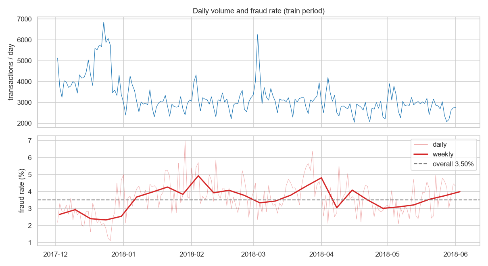

# Fraud Detection and Explainable AI Platform

An end-of-studies (PFA) project to build a platform that **scores payment transactions for fraud risk**, **explains each score** in plain language, and **ranks suspicious cases** for human review. It is built on the IEEE-CIS Fraud Detection dataset (real e-commerce transactions from Vesta Corporation).

> **Status: in progress.** Data ingestion and exploratory analysis, the time-safe feature pipeline, the evaluation framework, the production model (calibrated LightGBM with a cost-based alert rule, evaluated once on the test period), the anomaly safety net, plain-language SHAP explanations, the **scoring API** (`POST /api/v1/score` and a batch scoring script, with the model registry in PostgreSQL), **authentication with an append-only audit trail** the **review queue API** (cases, claim/assign, decisions, threshold and cost settings, CSV export) the **analyst dashboard** (login, review queue, case detail with a SHAP waterfall, decisions and timeline) **monitoring** (day-by-day replay of the test period, performance, PSI/KS drift, dashboard page) and **model management** (offline retraining from the replayed labels, champion/challenger comparison, activation without restart, threshold and costs page) are complete. Final tests, documentation and demo preparation come next. See [Project status](#project-status).

---

## Contents
- [The problem](#the-problem)
- [Dataset](#dataset)
- [Architecture and repository structure](#architecture-and-repository-structure)
- [Setup](#setup)
- [Usage: verified commands](#usage-verified-commands)
- [Completed work: data ingestion and EDA](#completed-work-data-ingestion-and-eda)
- [Completed work: feature pipeline](#completed-work-feature-pipeline)
- [Completed work: evaluation and baselines](#completed-work-evaluation-and-baselines)
- [Completed work: production model and test results](#completed-work-production-model-and-test-results)
- [Completed work: anomaly safety net](#completed-work-anomaly-safety-net)
- [Completed work: SHAP explanations](#completed-work-shap-explanations)
- [Completed work: scoring API](#completed-work-scoring-api)
- [Completed work: authentication and audit trail](#completed-work-authentication-and-audit-trail)
- [Completed work: review queue](#completed-work-review-queue)
- [Completed work: analyst dashboard](#completed-work-analyst-dashboard)
- [Completed work: monitoring](#completed-work-monitoring)
- [Completed work: model management and retraining](#completed-work-model-management-and-retraining)
- [Key findings](#key-findings)
- [Chronological split](#chronological-split)
- [Leakage safeguards](#leakage-safeguards)
- [Project status](#project-status)
- [Limitations](#limitations)
- [Reproducibility](#reproducibility)

---

## The problem

Fraud is rare (about 3.5% of transactions in this dataset, often much less in production), but every missed fraud costs money and every false alarm costs analyst time and customer goodwill. Accuracy is therefore a misleading metric: a model that never flags anything is 96.5% "accurate". The platform is designed around:

- **Imbalance-aware evaluation:** PR-AUC, recall at a fixed precision, and precision within a daily review capacity.
- **Business cost:** missed fraud amount vs. review cost, used to choose the alert threshold.
- **Explainability:** SHAP-based, analyst-readable risk factors for each scored transaction.
- **Time-aware validation and leakage control:** models are always evaluated on a later period than they were trained on.

## Dataset

| | |
|---|---|
| Source | [IEEE-CIS Fraud Detection](https://www.kaggle.com/competitions/ieee-fraud-detection) (Kaggle competition, data provided by Vesta Corporation) |
| Files used | `train_transaction.csv`, `train_identity.csv`, `test_transaction.csv`, `test_identity.csv`, `sample_submission.csv` |
| Labelled data | 590,540 transactions, 394 transaction columns + 41 identity columns (joined on `TransactionID`), target `isFraud` |
| Unlabelled data | 506,691 transactions (Kaggle test period), used only for drift analysis |
| Expected location | `data/raw/` (raw CSVs) → `data/processed/` (generated Parquet) |

**The dataset is not included in this repository.** It is distributed by Kaggle under the competition's rules, which you must accept before downloading. The two transaction files are also far larger than GitHub's per-file limit (652 MiB and 585 MiB). To reproduce the results:

1. Sign in to Kaggle, open the competition page and accept the rules.
2. Download the data from the **Data** tab and place the five CSV files in `data/raw/`.
3. Run the verification script (below). It checks that all files are present with the exact official row counts.

## Architecture and repository structure

The target system is a web platform: a **FastAPI** backend with **PostgreSQL**, a **React + TypeScript** dashboard, and an ML package shared between offline training and online scoring, all orchestrated with **Docker Compose**. The parts implemented so far are marked below.

```
.
├── docker-compose.yml        # PostgreSQL 16, FastAPI backend, React frontend, Adminer   [implemented]
├── .env.example              # environment template (copy to .env)                        [implemented]
├── backend/                  # FastAPI app (installs the fraudml package; no copy of feature code)
│   ├── alembic/              # database migrations (applied on container start)            [implemented]
│   ├── app/
│   │   ├── api/v1/           # health, auth, users, POST /score, cases, settings, reports, monitoring, models [implemented]
│   │   ├── db/models.py      # transactions, models, predictions, users, audit, cases, settings [implemented]
│   │   ├── schemas/          # request/response models (raw IEEE-CIS field names)         [implemented]
│   │   ├── core/security.py  # bcrypt passwords, JWT access tokens, refresh-token hashing [implemented]
│   │   ├── services/         # history, registry, scoring, loader, auth, users, audit, cases, settings, monitoring [implemented]
│   │   └── scripts/          # load_transactions, register_model, score_batch, open_cases, replay, compute_monitoring, export_training_data, check_skew_db, seed_users [implemented]
│   └── tests/                # API, workflow, registry, history, loader, migration tests (separate test DB)
├── frontend/                 # React 19 + TypeScript + Vite + Mantine: analyst dashboard    [implemented]
│   └── src/
│       ├── api/              # generated API types (schema.d.ts), typed client, token refresh
│       ├── features/         # auth, queue (+ CSV export), case (detail, SHAP, decisions), monitoring, admin (models, threshold and costs)
│       ├── layouts/ routes/  # app shell, routes (pages loaded on demand), 403/404/error pages
│       └── test/             # Vitest setup, render helpers, fixtures
├── ml/                       # "fraudml" Python package (Python 3.11)
│   ├── fraudml/
│   │   ├── config.py         # paths, dataset constants, split dates                      [implemented]
│   │   ├── data/ingest.py    # raw-file verification, merge, downcast, Parquet export     [implemented]
│   │   ├── data/split.py     # chronological train / gap / validation / gap / test split  [implemented]
│   │   ├── features/         # time-safe feature pipeline (batch + online), encoder        [implemented]
│   │   ├── evaluate/         # metrics, cost model, capacity-constrained threshold        [implemented]
│   │   ├── models/           # loader, baselines, LightGBM/XGBoost, CV folds, tuning, calibration, anomaly [implemented]
│   │   ├── explain/          # SHAP contributions, masked-feature groups, plain-language factors [implemented]
│   │   ├── monitoring/       # drift: reference bins, PSI, KS, severity                    [implemented]
│   │   └── registry.py       # file-based model artifacts (model.txt + calibrator/metadata JSON) [implemented]
│   ├── scripts/
│   │   ├── verify_raw_data.py
│   │   ├── make_parquet.py
│   │   ├── build_features.py # feature datasets + fitted encoder
│   │   ├── check_skew.py     # batch-vs-online consistency check on real data
│   │   ├── train_baselines.py # baseline model comparison on the validation period
│   │   ├── tune_lgbm.py      # Optuna tuning (time-ordered folds inside train)
│   │   ├── train_final.py    # comparison, calibration, alert policy, model artifact
│   │   ├── evaluate_test.py  # single evaluation on the test period
│   │   ├── train_anomaly.py  # Isolation Forest safety net: fit, cut-off, validation analysis
│   │   ├── evaluate_anomaly_test.py # single test check of the safety net
│   │   └── explain_model.py  # SHAP checks, global figures, example explanations
│   ├── notebooks/01_eda.ipynb  # exploratory data analysis                                 [implemented]
│   └── tests/                # unit, leakage and training/serving consistency tests
├── docs/eda_findings.md      # one-page summary of the EDA results
├── docs/features.md          # feature dictionary (meaning of every model feature)
├── reports/                  # model comparison tables, findings and figures (figures/eda: EDA notebook)
├── data/                     # raw + processed data (not versioned)
└── artifacts/                # fitted encoder, future trained models (not versioned)
```

## Setup

### Prerequisites
- **Python 3.11** (the ML package and the backend image both target 3.11)
- **Docker Desktop** (with WSL2 on Windows) for the application stack
- The IEEE-CIS CSV files in `data/raw/` (see [Dataset](#dataset))

### ML environment (host)
Commands below are for Windows (Git Bash or PowerShell), where they were verified. On Linux/macOS use `python3.11 -m venv` and `ml/.venv/bin/...` instead of `ml/.venv/Scripts/...`.

```bash
py -3.11 -m venv ml/.venv
ml/.venv/Scripts/python -m pip install -e "ml[eda,train,dev]"
```

Main dependencies (from `ml/pyproject.toml`): pandas, pyarrow, numpy, scipy; extras `eda` (matplotlib, seaborn, JupyterLab, nbconvert) and `dev` (pytest, ruff).

### Application stack (Docker)
```bash
cp .env.example .env            # then set POSTGRES_PASSWORD, JWT_SECRET and the SEED_* passwords
docker compose up -d --build
```

| Service | URL |
|---|---|
| Analyst dashboard (log in with a seeded user) | http://localhost:5173 |
| API docs (Swagger) | http://localhost:8000/docs |
| Health check | http://localhost:8000/api/v1/health |
| Adminer (database browser) | http://localhost:8080 |
| PostgreSQL from the host | `localhost:5433` |

Database migrations run automatically when the backend starts. To serve the model (after the ML steps produced `data/processed/` and `artifacts/`), run once inside the backend container:

```bash
# 1. Customer history: every labelled transaction before the test period (490,555 rows, ~30 s)
docker compose exec backend python -m app.scripts.load_transactions --until 2018-04-28 --source history
# 2. Register and activate the model bundle, then restart the API so it loads it
docker compose exec backend python -m app.scripts.register_model lgbm-2026.10.27-1 --anomaly iforest-2026.10.27-1 --activate
docker compose restart backend
# 3. Optional: load and score the first test day (3,060 rows, ~7 min; scoring opens the review cases)
docker compose exec backend python -m app.scripts.load_transactions --from 2018-04-28 --to 2018-04-29 --source batch
docker compose exec backend python -m app.scripts.score_batch --from 2018-04-28 --to 2018-04-29
# 4. Demo users: 1 admin + 2 analysts, passwords from .env (re-running skips existing users)
docker compose exec backend python -m app.scripts.seed_users
```

Every endpoint except the health check and login needs a logged-in user. In Swagger (http://localhost:8000/docs), click **Authorize** and log in with an e-mail and password.

## Usage: verified commands

Run from the repository root.

| Task | Command | Expected result |
|---|---|---|
| Verify raw data | `ml/.venv/Scripts/python ml/scripts/verify_raw_data.py` | 5 files OK with official row counts; exit code 0 |
| CSV → Parquet | `ml/.venv/Scripts/python ml/scripts/make_parquet.py` | `data/processed/train.parquet` (590,540 × 435) and `test.parquet` (506,691 × 434) |
| Build feature datasets | `ml/.venv/Scripts/python ml/scripts/build_features.py` | `data/processed/features_{train,validation,test}.parquet` (353,716 / 97,344 / 99,985 rows, 59 features) and `artifacts/feature_encoder.json` |
| Batch-vs-online check | `ml/.venv/Scripts/python ml/scripts/check_skew.py` | `mismatches: 0`, future invariance identical, `RESULT: PASS` (about 2–3 min) |
| Baseline comparison | `ml/.venv/Scripts/python ml/scripts/train_baselines.py` | 5 models trained on train, evaluated on validation; `reports/baselines_comparison.{csv,md}`, `baselines_bootstrap.csv`, `figures/baselines_pr_curves.png`, `figures/baselines_cost_curve.png`; prints `test set not read` (about 2 min) |
| Tune LightGBM | `ml/.venv/Scripts/python ml/scripts/tune_lgbm.py` | 30 Optuna trials (resumable SQLite study in `artifacts/optuna/`), `reports/tuning_best_params.json` (about 25 min) |
| Final model | `ml/.venv/Scripts/python ml/scripts/train_final.py --save` | validation comparison + calibration + alert policy → `reports/model_validation.{csv,md}`, figures, artifact `artifacts/models/lgbm-<date>-<n>/` (round trip checked; about 2 min) |
| Test evaluation (once) | `ml/.venv/Scripts/python ml/scripts/evaluate_test.py` | `reports/test_results.{json,md}` + figures; refuses a second run (`--dry-run` checks the code on validation) |
| Anomaly safety net | `ml/.venv/Scripts/python ml/scripts/train_anomaly.py --save` | Isolation Forest fitted on train (no labels), cut-off = top 0.5% of train; `reports/anomaly_validation.{csv,md}`, figures, artifact `artifacts/models/iforest-<date>-<n>/` (about 15 s) |
| Safety-net test check (once) | `ml/.venv/Scripts/python ml/scripts/evaluate_anomaly_test.py` | `reports/anomaly_test_results.{json,md}`; refuses a second run (`--dry-run` checks the code on validation) |
| SHAP explanations | `ml/.venv/Scripts/python ml/scripts/explain_model.py` | additivity and `shap` cross-check, `reports/figures/shap_{importance,beeswarm}.png`, `reports/shap_examples.md` (about 30 s) |
| Drift reference | `ml/.venv/Scripts/python ml/scripts/build_drift_reference.py --model lgbm-2026.10.27-1` | `artifacts/monitoring/drift_reference-<model>.json` (59 features from train, score from validation; self-check PSI 0; about 6 s) |
| Retrain (challenger) | `docker compose exec -T backend python -m app.scripts.export_training_data --from 2018-04-28 --to 2018-05-26 > data/processed/replayed_labelled.parquet`, then `ml/.venv/Scripts/python ml/scripts/retrain.py`, then `docker compose exec backend python -m app.scripts.register_model <version> --anomaly iforest-2026.10.27-1` | 82,233 exported rows; candidate artifact + drift reference + `reports/retrain_comparison.md` (about 20 s); registered as `candidate` |
| ML tests | `ml/.venv/Scripts/python -m pytest ml/tests -q` | 172 tests pass (about 60 s) |
| ML lint | `ml/.venv/Scripts/ruff check ml` | no issues |
| Run the EDA notebook | `cd ml/notebooks && ../.venv/Scripts/jupyter nbconvert --to notebook --execute --inplace --ExecutePreprocessor.timeout=1200 01_eda.ipynb` | runs end to end; figures written to `reports/figures/eda/` |
| Load transactions | `docker compose exec backend python -m app.scripts.load_transactions --until 2018-04-28 --source history` | `inserted 490,555 new rows`; a re-run inserts 0 (about 30 s) |
| Register the model | `docker compose exec backend python -m app.scripts.register_model lgbm-2026.10.27-1 --anomaly iforest-2026.10.27-1 --activate` | one `active` row in `model_versions`; after a restart `/api/v1/health` shows both versions |
| Seed demo users | `docker compose exec backend python -m app.scripts.seed_users` | 3 users created (admin + 2 analysts); a re-run creates 0; refuses placeholder passwords |
| Log in | `curl -c cookies.txt -X POST localhost:8000/api/v1/auth/login -d "username=<e-mail>&password=<password>"` | 200 with `access_token`; refresh token stored as an httpOnly cookie |
| Score one transaction | `curl -X POST localhost:8000/api/v1/score -H "Authorization: Bearer <access_token>" -H "Content-Type: application/json" -d @txn.json` | 200 with calibrated score, expected loss, alert, risk level, unusual flag and top 10 factors |
| Batch scoring | `docker compose exec backend python -m app.scripts.score_batch --from 2018-04-28 --to 2018-04-29` | 3,060 rows, 154 alerts; a re-run scores 0 (about 7 min); opens one review case per alert / unusual flag |
| Open review cases (backfill) | `docker compose exec backend python -m app.scripts.open_cases --from 2018-04-28 --to 2018-04-29` | for predictions stored before the review queue existed: 156 cases (154 model alerts + 2 unusual); a re-run opens 0 |
| Review queue | `curl -H "Authorization: Bearer <access_token>" "localhost:8000/api/v1/cases?status=new&limit=10"` | the 10 highest-priority open cases and the total |
| Export cases | `curl -H "Authorization: Bearer <access_token>" -o cases.csv "localhost:8000/api/v1/reports/cases.csv?status=closed"` | CSV with one row per case and its final decision (no ground truth) |
| Replay test days | `docker compose exec backend python -m app.scripts.replay --from 2018-05-26 --to 2018-05-27 --workers 4` | per day, in order: load → score (opens cases) → reveal labels → monitoring; re-running a day changes nothing; about 5–6 min per day |
| Recompute monitoring | `docker compose exec backend python -m app.scripts.compute_monitoring --from 2018-04-28 --to 2018-05-26` | daily metrics + drift for every day (about 20 s for 28 days) |
| Skew check vs PostgreSQL | `docker compose exec backend python -m app.scripts.check_skew_db` | 1,000 rows: 0 feature mismatches, probability difference 0, 0 alert mismatches, `RESULT: PASS` (about 3–5 min; uses the model's own threshold, whatever the admin settings) |
| Backend tests | `docker compose exec backend pytest -q` | 203 tests pass (separate `fraud_test` database) |
| Backend lint | `docker compose exec backend ruff check .` | no issues |
| Frontend checks | `docker compose exec frontend npm run lint` / `npm run format:check` / `npm run build` | no errors (the build also type-checks against the generated API types) |
| Frontend tests | `docker compose exec frontend npm test` | 133 Vitest tests pass |
| Regenerate API types | `docker compose exec frontend npm run gen:api` | rewrites `frontend/src/api/schema.d.ts` from the running backend; no diff when the API is unchanged |

To open the notebook interactively: `ml/.venv/Scripts/jupyter lab`. You can also register the environment as a kernel with `ml/.venv/Scripts/python -m ipykernel install --user --name fraudml`.

## Completed work: data ingestion and EDA

**Data ingestion** (`ml/fraudml/data/ingest.py`):
- verifies the five raw files and their exact row counts;
- renames the test identity columns (`id-01` → `id_01`) so train and test share one schema;
- left-joins identity data onto transactions (`TransactionID`, one-to-one check);
- adds `TransactionDatetime` from the `TransactionDT` seconds offset (reference date 2017-12-01, a common convention);
- downcasts types (float64 → float32, smallest integer types, text → category) while keeping `TransactionAmt` in float64 so cents stay exact;
- writes compressed Parquet. Memory drops from ~1.98 GB to ~0.93 GB for the training data, and loading takes about 1 second. Values were checked to be identical to the CSVs, missing-value patterns included.

**Exploratory analysis** (`ml/notebooks/01_eda.ipynb`, summary in [`docs/eda_findings.md`](docs/eda_findings.md)):
size and column groups, target imbalance, missing values, readable features vs. fraud, time coverage, chronological split, drift (PSI), a pseudo customer key, and leakage checks.

## Completed work: feature pipeline

`ml/fraudml/features/` turns raw transactions into **59 curated features** (full list with plain-language meanings in [`docs/features.md`](docs/features.md)):
- **row-level:** hour, weekday, amount (log, cents, round flag), product, card network/type, e-mail domains and a same-domain flag, device type, browser and OS *family*, missing-data flags, masked `C`/`M` columns, and drift-free `day − D` versions of key `D` columns;
- **customer behaviour, past only:** earlier transactions, last-24 h count and amount, usual amount, amount vs. usual amount, how unusual the amount is, time since the previous transaction, first time on a device / e-mail domain;
- **encoding fitted on the train period only:** rare or unseen categories become `other`; card, region, e-mail and device frequencies are learned from train.

The **same code** computes features for a whole dataset (training) and for **one transaction plus its history** (future scoring API). Tests prove:
- **training/serving consistency:** online features equal batch features for every synthetic row, and for 1,992 sampled real validation/test transactions (0 mismatches, max difference 3e-11), including same-second transactions, customers without a key, long histories and unseen categories;
- **no look-ahead:** removing all later transactions never changes a feature (synthetic data and 48,672 real validation rows);
- **no label use:** flipping or removing `isFraud` leaves every feature unchanged;
- **no identifiers:** `TransactionID`, `uid`, timestamps and evaluation flags can never appear in a feature list.

Feature datasets keep `TransactionID`, `TransactionDT`, `period`, `isFraud` and the evaluation-only flag `uid_fraud_in_train` (validation 965 rows, test 663 rows) as separate columns, never as features.

## Completed work: evaluation and baselines

`ml/fraudml/evaluate/` measures models the way the business sees them: PR-AUC, recall at precision ≥ 0.5, precision within each day's top 150 alerts (analyst capacity), share of fraud **value** caught, and a cost model ($5 per review, $2 friction per false alarm, a missed fraud costs its amount). The alert threshold is chosen to minimise total cost while staying within 150 alerts per day on average. Every result is reported overall and excluding customers who already had a fraud in train.

Validation period results (models trained on the train period; test period untouched):

| Model | PR-AUC | Precision in daily top 150 | Net savings vs no model |
|---|---|---|---|
| Rule: amount > train p99 | 0.048 | 0.084 | $73k |
| Logistic regression | 0.450 | 0.369 | $223k |
| **LightGBM (defaults, no resampling)** | **0.565** | **0.453** | **$349k** |
| LightGBM + class weights | 0.542 | 0.428 | $325k |
| LightGBM + undersampling (probabilities corrected) | 0.555 | 0.444 | $352k |

A day-level bootstrap shows LightGBM without resampling is best on ranking, and class weights are clearly worse. Review capacity, not the model, limits savings: cost keeps falling up to about 500 alerts/day. Details: [`reports/baselines_findings.md`](reports/baselines_findings.md).


## Completed work: production model and test results

The production model is **LightGBM with default settings** on the 59 curated features, with isotonic calibration and a cost-based alert rule. Alert a transaction when **expected loss = fraud probability × amount ≥ $21.82**, capped by the analysts' capacity of 150 alerts/day.

| Test period (evaluated once, 2018-04-28 → 06-01) | Result |
|---|---|
| Fraud value caught | **65.5%** (target ≥ 50%) |
| Net savings vs no model | **$303k of $516k** fraud losses (59%) |
| Alerts per day (mean / max) | 153 / 210 |
| Precision of alerts | 0.25 |
| PR-AUC (overall / excluding repeat-fraud customers) | 0.454 / 0.455 (validation 0.559) |
| PR-AUC of alternatives on test | XGBoost 0.440 · logistic regression 0.372 · amount rule 0.036 |

What the experiments showed:
- **Tuning was rejected.** Optuna's gain (+0.009 PR-AUC, not significant) came only from re-identifying customers who were already caught in train; for everyone else it was significantly worse (−0.015). A higher headline score can hide leakage.
- **Expected-loss alerting beats probability alerting.** It saves 27% more on validation ($434k vs $342k) at the same alert volume.
- **Readable features cost little.** Using all 409 raw columns raises PR-AUC (0.595 vs 0.565) but not savings ($343k vs $349k).
- **Drift is visible.** Test performance is lower than validation, but stable week to week (62–70% of fraud value caught each week). This motivates the monitoring and retraining steps.

Details: [`reports/model_findings.md`](reports/model_findings.md).



## Completed work: anomaly safety net

An **Isolation Forest** (unsupervised, fitted on the train period without labels) flags unusual transactions. Transactions that the main model did not alert but that are among the 0.5% most unusual of the train period are flagged as an "unusual pattern".

| | Validation | Test (checked once) |
|---|---|---|
| Extra alerts per day | 2.9 | 2.8 |
| Extra frauds caught | 9 (precision 9.4%) | 1 (precision 1.0%) |
| Net savings change | +$117 | −$516 |

**Result:** the safety net adds almost nothing here. Most unusual transactions are already caught by the main model, and on test the remaining extra alerts are less precise than random review. It is kept only as a **low-priority "unusual pattern" flag** (about 3 per day, reviewed when capacity is left). A one-off burst of unusual transactions in December 2017 also makes the train-based cut-off stricter than intended, which argues for refitting it on recent traffic. Details: [`reports/anomaly_findings.md`](reports/anomaly_findings.md).

## Completed work: SHAP explanations

Every transaction gets its **top risk factors in plain language**, computed with LightGBM's built-in exact SHAP values (identical to the `shap` library, about 18 ms per transaction). Anonymised columns are grouped into four families and never named.

> Amount $554: moderately raises risk
> 24.5 h since this customer's previous transaction: moderately raises risk
> Card type is credit: strongly raises risk

The explanation object (top 10 factors with direction, strength and a `masked` flag) is ready to be stored with each prediction. The anonymised families drive the score most, so the case page will list readable reasons first. Factors describe what moved the model's score, not causes. Details and 10 reviewed examples: [`reports/shap_findings.md`](reports/shap_findings.md), [`reports/shap_examples.md`](reports/shap_examples.md).



## Completed work: scoring API

`POST /api/v1/score` takes one raw transaction (IEEE-CIS field names; only id, time and amount are required). It returns a calibrated fraud probability, the expected loss (probability × amount), the alert decision (expected loss ≥ $21.82 by default; an admin can change it), a risk level (low < 5% · medium < 20% · high < 50% · critical), the "unusual pattern" flag and the top 10 plain-language factors. The transaction and its prediction are stored in PostgreSQL.

- **One feature pipeline:** the backend installs the `fraudml` package and calls its online feature path. Only the history lookup is new (the customer's earlier transactions, read from PostgreSQL).
- **Model registry:** `model_versions` holds each scoring bundle (LightGBM model, calibrator, alert policy, linked Isolation Forest). Registration refuses artifacts trained with another feature encoder or other library versions. At most one bundle is active, and the API loads it at startup.
- **Safe to retry:** the same transaction sent twice returns the stored prediction; different data under the same id is rejected (409). Ground truth can never be sent (`isFraud` → 422) and is never returned.
- **Batch scoring** uses the same service for a date range of stored transactions.

**Training–serving consistency, re-checked on PostgreSQL:** for 1,000 random validation and test transactions, features computed by the API path equal the offline training features (0 mismatches over 59 features, largest difference 2e-12), and probabilities are identical. The first test day scored in batch (3,060 transactions) reproduces offline scoring exactly: same probabilities, same 154 alerts, same 2 unusual flags.

Scoring takes about 140 ms per transaction (features 66 ms, Isolation Forest 30 ms, SHAP 24 ms, LightGBM 10 ms, history query 4 ms).

## Completed work: authentication and audit trail

- **Login** (`POST /auth/login`, OAuth2 password form) returns a 15-minute JWT access token, sent as `Authorization: Bearer …`. A 7-day refresh token is set as an **httpOnly cookie** (SameSite=Strict, limited to `/api/v1/auth`), so page scripts cannot read it. `POST /auth/refresh` swaps it for a new one each time. If an already-used refresh token is presented again, it is treated as stolen and all of that user's sessions are revoked. `POST /auth/logout` revokes it.
- **Stored safely:** passwords are hashed with bcrypt (10 to 72 bytes). Only a SHA-256 hash of each refresh token is stored. A wrong password and an unknown e-mail get the same answer, so the login does not reveal which accounts exist.
- **Two roles:** analyst and admin. `GET/POST /users` is admin only. The user is re-read on every request, so a deactivated account or a changed role takes effect immediately. `POST /score` needs any logged-in user.
- **Demo users** come from a seed script, with passwords taken only from `.env`.
- **Audit trail:** every state-changing action writes one row to `audit_logs` in the same transaction as the change: `auth.login`, `auth.login_failed` (with a reason, never the password), `auth.logout`, `auth.token_reuse`, `user.create`, `model.register` and `model.activate`. **PostgreSQL itself refuses UPDATE, DELETE and TRUNCATE** on this table (trigger), and a user with audit history cannot be deleted. The audit service also refuses any field that looks like a password or token.

## Completed work: review queue

Every alert becomes a **case** that an analyst reviews. All endpoints need a logged-in user; settings are admin only.

- **Cases are opened by scoring** (API and batch, same database transaction): an alert opens a tier-1 case (reason "model score"), an "unusual pattern" flag a tier-2 case. One case per transaction. A backfill script does the same for predictions stored earlier.
- **Queue order:** model alerts first, ranked by **expected loss** (probability × amount, the quantity the threshold was optimised on), then unusual-pattern cases. Case id breaks ties, so pages are stable. Days with more than 150 alerts are not cut: unreviewed cases stay in the queue.
- **`GET /cases`** filters by status, risk level, reason, assignee (`me`, `unassigned` or a user), amount and transaction date, sorts by priority, amount or time, and pages results with a total. **`GET /cases/{id}`** adds the transaction facts, the score and plain-language risk factors, the customer's 10 earlier transactions (with a "had a case" flag only) and the decisions.
- **Workflow:** `claim` (`new` → `assigned`), `assign` (admin), `decision`: *confirmed fraud* or *false positive* closes the case; *escalate* (comment required) unassigns it for an admin to claim and close. Only the assigned person can decide; closed cases cannot change. The case row is locked during a change, so two analysts cannot claim the same case.
- **Timeline:** `GET /cases/{id}/timeline` is read from the audit trail (`case.create` by the system, `case.claim`, `case.assign`, `case.decide` with the comment).
- **Settings (admin):** `GET/PUT /settings/thresholds` (alert threshold override, `null` = the active model's $21.82, and the risk-level bands) and `GET/PUT /settings/costs` (review cost, false-alarm cost, daily capacity). Changes are audited with before/after values and apply to transactions scored afterwards, not retroactively.
- **CSV export:** `GET /reports/cases.csv` with the queue filters, in queue order, with the final decision and who made it. Cells that a spreadsheet would run as a formula are escaped.
- **Ground truth is never returned** by any case, timeline or export endpoint (checked by tests).

Checked on the demo database: 156 cases for the first test day (154 model alerts + 2 unusual); an analyst claims and confirms the top case ($994, expected loss $481) while a second analyst is refused (409/403); an escalated case is closed by an admin; the timeline, settings changes and CSV export each match the audit rows written.

## Completed work: analyst dashboard

A React + TypeScript web app (Mantine UI, TanStack Query and Table) on top of the API. Analysts and admins log in with a seeded account.

- **Login and session:** the short-lived access token is kept in memory only (never in browser storage); the refresh token is an httpOnly cookie. A page reload restores the session with **one** refresh request, and requests that fail with 401 share a single refresh before retrying (the backend treats a refresh token used twice as stolen). Pages need a logged-in user; admin-only pages show a 403 page to analysts.
- **Review queue:** tabs *Open* / *My cases* / *All*; filters (risk level, reason, amount, transaction date, status); sortable columns (expected loss, amount, time, age) and pages, all done by the API and **kept in the address bar** (reload, back button and shared links keep the view); *Claim*, and *Assign* for admins.
- **Case detail:** score gauge (probability as a whole percent), risk level, expected loss, "unusual pattern" note, transaction facts, the customer's earlier transactions, and a **SHAP waterfall**: bars start at a typical transaction, each factor pushes the risk up (red) or down (green), and the last bar lands on this case's score. The plain-language reasons are listed next to it, readable ones first, anonymised signals after.
- **Decisions:** only the analyst holding the case can decide; closing a case asks for confirmation; escalating needs a comment and hands the case to the admins. The **timeline** turns the audit trail into sentences ("Escalated to the admins", "Decision: false positive", with comments).
- **Typed against the API:** TypeScript types are generated from the backend's OpenAPI description, so a backend change that breaks the UI fails the build (this caught a mismatch on the first build).
- **Ground truth is never shown:** the API never returns it, and the built app contains no reference to it.

Checks: 87 Vitest tests (token refresh, page guards, URL ↔ filters, the waterfall data and its drawn SVG, decision rules, timeline sentences). On the demo data every one of the 156 explanations adds up exactly.

## Completed work: monitoring

The test period is **replayed day by day through the real system**: each day's transactions are loaded, scored by the API's scoring service (which opens review cases), then that day's labels are revealed for monitoring only (the analyst UI never shows them). 28 days (2018-04-28 → 05-25, 82,233 transactions) are replayed; the last test week is kept for the live demo.

- **Exact check:** the weekly results computed from the replay equal the one-time offline test evaluation for all 4 weeks (transactions, alerts per day, precision, fraud $ caught, net savings, to 3e-16). This verifies loading, customer history, features, scoring, labels and metrics together on real data.
- **Performance per day** (same code as the offline evaluation): precision and recall of the alerts, PR-AUC, precision within the 150/day capacity, share of fraud dollars caught, total cost and net savings. Daily counts are stored, so weeks and periods are summed exactly.
- **Drift** against a reference built once: training-period features (10 quantile bins + a missing-value bin, or one bin per category) and validation-period scores. PSI decides the severity (< 0.1 stable, ≤ 0.25 moderate, above significant); KS is reported but not used, since with ~2,900 rows a day its p-value flags harmless differences. `weekday` is not monitored per day (a one-day window always holds one weekday).
- **Dashboard page** (`/monitoring`, analysts and admins): KPI cards (last 7 days vs the whole period), daily performance chart, alert volume with the capacity line and the open backlog, a drift heatmap (model score + the 15 most drifting features), analyst feedback.
- **Replay speed:** about 5–6 minutes per day with 4 worker processes (results identical to scoring one by one, checked by the weekly comparison).

| Replayed period (28 days) | Value |
|---|---|
| Alerts per day | 151.3 (capacity 150; 14 of 28 days above it) |
| Precision / recall of alerts | 24.0% / 37.9% |
| PR-AUC | 0.440 |
| Fraud $ caught | 63.9% |
| Net savings | $219,148 |

**What the drift shows:** the four normalised "days since" features (`D1n`, `D4n`, `D10n`, `D15n`) drift strongly every day (PSI 1.3–2.4) because they grow with the calendar, and the `M1`–`M9` match flags drift on most days (PSI ≈ 0.6). Yet **the model's score distribution stays stable on 27 of 28 days** (mean PSI 0.03), and precision holds. The exception is 2018-05-21 (score PSI 0.32, only 83 alerts): exactly the kind of day the dashboard is meant to surface.

## Completed work: model management and retraining

The feedback loop is closed with an **offline retraining script** and **manual champion/challenger promotion**.

- **Retraining** uses the labels now in the database (revealed labels of replayed days, else analyst decisions). The challenger is trained on the original train + validation periods + replayed week 1; week 2 is a gap; week 3 calibrates it and sets its cost-optimal threshold; **week 4 (2018-05-19 → 05-25) is never used for fitting** and serves to compare both models on the same transactions. Same features, encoder and LightGBM recipe as the current model.
- **Result** (`reports/retrain_comparison.md`, 19,941 transactions):

| Week 4 | Current model | Retrained candidate |
|---|---:|---:|
| PR-AUC (excluding customers with a fraud in training) | 0.432 (0.454) | **0.532 (0.519)** |
| Precision / recall of alerts | 25.7% / 36.7% | **35.2% / 45.7%** |
| Fraud $ caught | 64.5% | **71.0%** |
| Net savings | $64,265 | **$72,307** |
| Alerts per day | 149 | 136 |

  The PR-AUC gain is +0.100 with a 95% interval of [+0.064, +0.140] (bootstrap over whole days). Newer training data (closer to the drifted period) is the likely reason.
- **Model management page** (admin): the candidate next to the current model on the comparison week (all customers / excluding past-fraud customers, with the confidence of the gain), the versions table, and **Activate** / **Archive**. Activation is audited, archives the previous model, resets a custom threshold to the new model's own, and switches the API to the new model **without a restart** (it is loaded first; a broken artifact changes nothing). A previous model can be re-activated.
- **Threshold and costs page** (admin): use the model's threshold or a custom one, the risk-level bounds, the review / friction costs and the daily capacity, with the same validation as the API, next to the training cost curve that explains the threshold.
- **Export CSV** button on the review queue (current filters).

## Key findings

- **Fraud rate: about 3.50%** in the labelled data (20,663 of 590,540; 1 fraud for every 27.6 legitimate transactions), about 113 frauds per day. The weekly rate varies between 2.3% and 4.9%.
- **Mostly masked features:** about 415 of 434 columns are anonymised (`V`, `C`, `D`, `M`, `id_`). Analyst-readable explanations will rely on engineered features built from the readable columns.
- **Missing values carry signal:** identity data exists for 24.4% of transactions, and those transactions are 3.8× riskier (7.85% vs 2.09%).
- **Strong readable signals:** product C (11.7% fraud vs 2.0% for W), credit vs debit cards (6.7% vs 2.4%), mobile devices (10.2%), low-volume hours of the day (up to 10.6%), certain e-mail domains. Raw amount alone is a weak signal.
- **Drift:** browser version (`id_31`) and some time-delta columns (`D15`) drift strongly over time; amount and card features are stable.
- **No single-column leak:** the best single numeric column reaches ROC-AUC 0.69.



## Chronological split

The model will predict *future* transactions, so data is split by time, never randomly. There is a **7-day gap** before validation and before test, so look-back features and late-arriving labels cannot leak across periods.

| Period | Dates (inclusive) | Rows | Share | Fraud rate |
|---|---|---|---|---|
| Train | 2017-12-02 → 2018-03-11 | 353,716 | 59.9% | 3.38% |
| Gap | 2018-03-12 → 2018-03-18 | 20,946 | 3.5% | – |
| Validation | 2018-03-19 → 2018-04-20 | 97,344 | 16.5% | 3.93% |
| Gap | 2018-04-21 → 2018-04-27 | 18,549 | 3.1% | – |
| Test | 2018-04-28 → 2018-06-01 | 99,985 | 16.9% | 3.43% |

Gap rows are not used for training or scoring. They may be used as past history when computing behavioural features.


## Leakage safeguards

The EDA confirmed strong **label propagation**: when a pseudo customer (`uid = card1 + addr1 + (day − D1)`) has a fraudulent transaction, their next transaction is fraudulent 87.2% of the time (vs 0.36% otherwise). Therefore:

1. **No features built from past labels** of the same customer or card. In practice, labels (chargebacks) arrive weeks later.
2. **No raw identifiers as features:** neither `uid` nor `TransactionID`. Only aggregates over *past* transactions are allowed.
3. **Test metrics are reported twice:** overall, and excluding customers who already had a fraud in the training period. That small group (0.7% of test rows) accounts for about 10% of test frauds and would otherwise inflate results.
4. Encoders, scalers and any resampling are fitted on training data only; behavioural aggregates use strictly earlier transactions.
5. Rare high-cardinality categories (e.g. specific device models) will be grouped or frequency-encoded to avoid memorisation.

## Project status

| Stage | Status |
|---|---|
| Infrastructure skeleton (Docker Compose, PostgreSQL, FastAPI health endpoint, React status page) | ✅ done |
| **Data ingestion and exploratory analysis** | ✅ done |
| **Feature engineering, chronological split, training/serving consistency test** | ✅ done |
| **Evaluation framework, baselines and imbalance handling** | ✅ done |
| **Model selection (LightGBM/XGBoost), calibration, cost-based threshold, test evaluation** | ✅ done |
| **Anomaly detection safety net (Isolation Forest)** | ✅ done |
| **SHAP explanations (local factors, plain-language reasons, global figures)** | ✅ done |
| **Scoring API: database schema, model registry, `POST /score`, batch scoring** | ✅ done |
| **Authentication and roles, audit trail** | ✅ done |
| **Review queue and case workflow (API)** | ✅ done |
| **Analyst dashboard (frontend)** | ✅ done |
| **Monitoring (day-by-day replay, drift, performance, dashboard page)** | ✅ done |
| **Admin pages (models, threshold and costs), retraining workflow** | ✅ done |
| **Final tests, model card, demo preparation** | ⏭ next |

**Next stage:** test coverage, model card, README polish and the defense demo (demo database snapshot, rehearsal, backup recording).

## Limitations

- Retraining is an offline script (no in-app trigger or schedule). The threshold page shows the cost curve from training; a live what-if simulator is not implemented. The Isolation Forest safety net is not retrained.
- No login rate limiting or account lock-out yet (failed logins are audited). Behind the Vite proxy, the audit log records the proxy's IP, not the browser's. Users cannot be edited, deactivated or have their password reset through the API yet (database only). The audit log is readable through the database (Adminer) and per case through the timeline endpoint, not through a full audit page. Case comments and bulk assignment are not implemented (the decision carries a comment). A prediction does not store the threshold in force when it was made (the audit trail records each threshold change).
- Performance drops from validation to test (PR-AUC 0.559 → 0.454) because of drift; probabilities are slightly too high on test (mean 4.2% vs 3.4% fraud rate).
- Scoring takes about 140–240 ms per transaction (shared pandas feature code, chosen to guarantee consistency with training). That is fine for single calls; replaying one day takes about 5–6 minutes even with 4 worker processes.
- Labels of a replayed day are revealed at once (real chargebacks arrive weeks later). The ~4,300 replayed cases stay open in the queue, since nobody reviews them.
- Most dataset features are anonymised, which limits how readable explanations can be.
- The pseudo customer key is an approximation: 11.3% of rows have none, and a few keys group many transactions.
- The time zone is unknown, so "hour of day" is relative to the reference date.
- Commands were verified on Windows 11 with Python 3.11.9 and Docker Desktop.

## Reproducibility

- **Data access:** a Kaggle account and acceptance of the IEEE-CIS competition rules are required. The data is not redistributed here.
- **Integrity check:** `verify_raw_data.py` fails if any file is missing or has an unexpected row count.
- **Deterministic pipeline:** ingestion, the EDA notebook and the feature build involve no randomness. Re-running `make_parquet.py`, the notebook and `build_features.py` reproduces the numbers and figures above. Model experiments use a fixed seed (42), so `train_baselines.py` and `train_final.py` reproduce the baseline and model tables (checked by re-running). The Optuna study is stored in SQLite and resumable.
- **Environment:** Python 3.11; dependencies declared in `ml/pyproject.toml`, `backend/pyproject.toml` and `frontend/package.json` (+ `package-lock.json`). Docker images pin `postgres:16`, `python:3.11-slim` and `node:22-alpine`.
