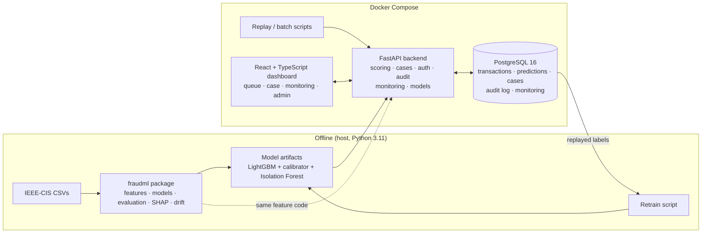

# Fraud Detection and Explainable AI Platform

A web platform that **scores card transactions for fraud risk**, **explains every score in plain language**, and **routes suspicious cases to analysts** in a ranked review queue — with monitoring of drift and performance, and an offline retraining loop with manual promotion of new models. Built on the IEEE-CIS Fraud Detection dataset (real e-commerce transactions from Vesta Corporation) as an end-of-studies project (PFA).

**Status: complete** (all planned features built and tested; see [Testing](#testing) and [Limitations](#limitations)).

## At a glance

| | |
|---|---|
| **Model** | LightGBM on 59 time-safe features, isotonic calibration, alert when *expected loss = probability × amount ≥ $21.82* within a capacity of 150 alerts/day; Isolation Forest as a low-priority "unusual pattern" flag |
| **Test period** (evaluated once, 5 weeks, 99,985 transactions) | **65.5% of fraud dollars caught**, **$303k saved** of $516k fraud losses, precision of alerts 25%, PR-AUC 0.454 |
| **Replay through the real system** (28 days, 82,233 transactions) | weekly results **identical** to the offline test evaluation (largest difference 3e-16) |
| **Retraining with the replayed labels** | on an untouched week, PR-AUC **0.432 → 0.532** (95% interval of the gain [+0.064, +0.140]), net savings $64k → $72k with fewer alerts |
| **Explanations** | top 10 SHAP factors per transaction as sentences ("Amount $400: strongly raises risk"), waterfall chart that adds up exactly to the score |
| **Tests** | 182 ML · 215 backend · 145 frontend, all passing; backend services 97.6% covered ([test report](docs/test_report.md)) |

## What it does

- **Analysts** log in, work through a **review queue** ranked by expected loss (tabs, filters, sorting, claim), open a **case** (score gauge, transaction facts, the customer's earlier transactions, SHAP waterfall and plain-language risk factors) and record a **decision**: confirmed fraud, false positive, or escalate to an admin. Every step appears in the case **timeline**.
- **Admins** also see the **monitoring dashboard** (performance per day, alert volume vs capacity, drift heatmap), **compare and activate models** (champion vs challenger, activation without restart), and change the **alert threshold, risk bands and business costs**.
- **Behind the scenes:** a real-time scoring API (`POST /api/v1/score`), JWT authentication with two roles, an **append-only audit trail** (the database refuses edits), a day-by-day **replay** of the test period, PSI/KS **drift** monitoring, and an offline **retraining** script. Ground-truth labels are used only for evaluation and monitoring — **never shown to analysts**.

## How it works



- **One feature pipeline:** the backend installs the same `fraudml` package used for training, so a transaction's features are computed by the same code in both places (verified: 0 mismatches between training and serving on real data).
- **Time-safe:** data is split by time with 7-day gaps; features only look at a customer's *earlier* transactions; no feature uses past labels (they would leak: a customer's next transaction after a fraud is fraud 87% of the time).
- **Cost-based alerting:** the threshold minimises the total cost (missed fraud + review + customer friction) under the analysts' daily capacity.

Details: [ML pipeline](docs/ml_pipeline.md) (data, features, models, explanations, results) · [Platform](docs/platform.md) (API, security, workflow, dashboard, monitoring, model management) · [Model card](docs/model_card.md) · [All commands](docs/commands.md).

## The problem

Fraud is rare (about 3.5% of transactions in this dataset, often much less in production), but every missed fraud costs money and every false alarm costs analyst time and customer goodwill. Accuracy is therefore a misleading metric: a model that never flags anything is 96.5% "accurate". The platform is designed around:

- **Imbalance-aware evaluation:** PR-AUC, recall at a fixed precision, and precision within a daily review capacity.
- **Business cost:** missed fraud amount vs. review cost, used to choose the alert threshold.
- **Explainability:** SHAP-based, analyst-readable risk factors for each scored transaction.
- **Time-aware validation and leakage control:** models are always evaluated on a later period than they were trained on.

## Quickstart

**Prerequisites:** Python 3.11, Docker Desktop (WSL2 on Windows), and the IEEE-CIS data (see [Dataset](#dataset)). Commands are for Windows (Git Bash or PowerShell), where they were verified; on Linux/macOS use `python3.11` and `ml/.venv/bin/...`.

```bash
# 1. Data: put the five Kaggle CSV files in data/raw/, then check them
py -3.11 -m venv ml/.venv && ml/.venv/Scripts/python -m pip install -e "ml[eda,train,dev]"
ml/.venv/Scripts/python ml/scripts/verify_raw_data.py

# 2. ML pipeline (about 5–10 minutes): Parquet, features, model, safety net, drift reference
ml/.venv/Scripts/python ml/scripts/make_parquet.py
ml/.venv/Scripts/python ml/scripts/build_features.py
ml/.venv/Scripts/python ml/scripts/train_final.py --save          # writes artifacts/models/lgbm-<date>-<n>/
ml/.venv/Scripts/python ml/scripts/train_anomaly.py --save        # writes artifacts/models/iforest-<date>-<n>/
ml/.venv/Scripts/python ml/scripts/build_drift_reference.py --model <lgbm version>

# 3. Application: configure, start, load history, register the model, create users
cp .env.example .env                                              # set the passwords and JWT_SECRET
docker compose up -d --build
docker compose exec backend python -m app.scripts.load_transactions --until 2018-04-28 --source history
docker compose exec backend python -m app.scripts.register_model <lgbm version> --anomaly <iforest version> --activate
docker compose restart backend
docker compose exec backend python -m app.scripts.seed_users       # 1 admin + 2 analysts

# 4. Replay a few test days (each ≈ 5–6 min): cases, labels, monitoring
docker compose exec backend python -m app.scripts.replay --from 2018-04-28 --to 2018-05-01 --workers 4
```

Then open **http://localhost:5173** and log in with a seeded user. Other addresses: API docs http://localhost:8000/docs (click **Authorize** to log in) · health http://localhost:8000/api/v1/health · Adminer http://localhost:8080 · PostgreSQL from the host `localhost:5433`.

The model versions used in this repository are `lgbm-2026.10.27-1` and `iforest-2026.10.27-1` (retrained candidate: `lgbm-2026.10.28-1`). Every other command — evaluation, tuning, retraining, skew checks, coverage — is listed with its expected result in [docs/commands.md](docs/commands.md).

## Dataset

| | |
|---|---|
| Source | [IEEE-CIS Fraud Detection](https://www.kaggle.com/competitions/ieee-fraud-detection) (Kaggle competition, data provided by Vesta Corporation) |
| Files used | `train_transaction.csv`, `train_identity.csv`, `test_transaction.csv`, `test_identity.csv`, `sample_submission.csv` |
| Labelled data | 590,540 transactions, 394 transaction columns + 41 identity columns (joined on `TransactionID`), target `isFraud` |
| Unlabelled data | 506,691 transactions (Kaggle test period), used only for drift analysis |
| Expected location | `data/raw/` (raw CSVs) → `data/processed/` (generated Parquet) |

**The dataset is not included in this repository.** It is distributed by Kaggle under the competition's rules, which you must accept before downloading. The two transaction files are also far larger than GitHub's per-file limit (652 MiB and 585 MiB). To reproduce the results:

1. Sign in to Kaggle, open the competition page and accept the rules.
2. Download the data from the **Data** tab and place the five CSV files in `data/raw/`.
3. Run `verify_raw_data.py` (Quickstart step 1). It checks that all files are present with the exact official row counts.

## Repository structure

```
.
├── docker-compose.yml       # PostgreSQL 16, FastAPI backend, React frontend, Adminer
├── .env.example             # environment template (copy to .env)
├── ml/                      # "fraudml" Python package, shared by training and the API
│   ├── fraudml/             # data · features (batch + online) · evaluate · models · explain · monitoring · registry
│   ├── scripts/             # one script per pipeline stage (verify, parquet, features, train, evaluate, explain, retrain …)
│   ├── notebooks/           # exploratory data analysis
│   └── tests/
├── backend/                 # FastAPI app
│   ├── alembic/             # database migrations (applied on start)
│   ├── app/                 # api/v1 · services · db models · schemas · scripts (load, replay, monitoring, export …)
│   └── tests/               # run against a separate test database
├── frontend/                # React 19 + TypeScript + Vite + Mantine
│   └── src/                 # api (generated types, client) · features (auth, queue, case, monitoring, admin) · routes
├── docs/                    # ML pipeline, platform, model card, commands, test report, EDA findings, feature list
├── reports/                 # experiment tables, findings and figures (committed)
├── data/                    # raw + processed data (not versioned)
└── artifacts/               # fitted encoder, model artifacts, drift references (not versioned)
```

## Testing

| Part | Tests | Coverage | Command |
|---|---:|---|---|
| ML package | 182 | 96% | `ml/.venv/Scripts/python -m pytest ml/tests -q` |
| Backend | 210 | services 97.6% | `docker compose exec backend pytest -q` |
| Frontend | 145 | 96% of lines | `docker compose exec frontend npm test` |

Beyond unit tests, end-to-end checks on real data: the training–serving **skew check** against PostgreSQL (`RESULT: PASS`), the **replay** reproducing the offline test evaluation week by week, and click-throughs of every page. Details, coverage per area and what is not covered: [docs/test_report.md](docs/test_report.md).

## Documentation

| Document | Contents |
|---|---|
| [docs/ml_pipeline.md](docs/ml_pipeline.md) | EDA findings, time split, leakage safeguards, features, baselines, production model and test results, safety net, SHAP |
| [docs/platform.md](docs/platform.md) | Scoring API, authentication and audit trail, review workflow, dashboard, monitoring, model management |
| [docs/model_card.md](docs/model_card.md) | Intended use, data, model, metrics, explanations, fairness, limitations |
| [docs/commands.md](docs/commands.md) | Every command with its expected result |
| [docs/test_report.md](docs/test_report.md) | Test counts and coverage |
| [docs/demo_script.md](docs/demo_script.md) | 15-minute demo flow, pre-demo check, database snapshot and restore |
| [docs/features.md](docs/features.md) · [docs/eda_findings.md](docs/eda_findings.md) | Feature dictionary · one-page EDA summary |
| [reports/](reports/) | Tables and figures of every experiment |

## Limitations

- Performance drops from validation to test (PR-AUC 0.559 → 0.454) because of drift; probabilities are slightly too high on test (mean 4.2% vs 3.4% fraud rate). Retraining with newer data recovers much of it (see the model card).
- Most dataset features are anonymised, which limits how readable explanations can be; the pseudo customer key is an approximation (11.3% of rows have none); the time zone is unknown, so "hour of day" is relative to the reference date.
- Scoring takes about 140–240 ms per transaction (shared pandas feature code, chosen to guarantee consistency with training): fine for single calls, but replaying one day takes about 5–6 minutes.
- Labels of a replayed day are revealed at once (real chargebacks arrive weeks later). The ~4,300 replayed cases stay open in the queue, since nobody reviews them.
- Retraining is an offline script (no in-app trigger or schedule). The threshold page shows the cost curve from training; a live what-if simulator is not implemented. The Isolation Forest safety net is not retrained.
- No login rate limiting or account lock-out (failed logins are audited). Behind the Vite proxy, the audit log records the proxy's IP. Users are managed by a seed script and a minimal API (no users page); the audit log is readable per case (timeline) and through the database, not on a dedicated page. Case comments and bulk assignment are not implemented.
- Commands were verified on Windows 11 with Python 3.11.9 and Docker Desktop.

## Reproducibility

- **Data access:** a Kaggle account and acceptance of the IEEE-CIS competition rules are required. The data is not redistributed here.
- **Integrity check:** `verify_raw_data.py` fails if any file is missing or has an unexpected row count.
- **Deterministic pipeline:** ingestion, the EDA notebook and the feature build involve no randomness. Model experiments use a fixed seed (42), so `train_baselines.py`, `train_final.py` and `retrain.py` reproduce their tables (checked by re-running). The one-time test evaluations refuse a second run.
- **Environment:** Python 3.11; dependencies declared in `ml/pyproject.toml`, `backend/pyproject.toml` and `frontend/package.json` (+ lock file). Docker images pin `postgres:16`, `python:3.11-slim` and `node:22-alpine`; the backend installs the exact library versions the models were trained with, and model registration refuses any mismatch.
