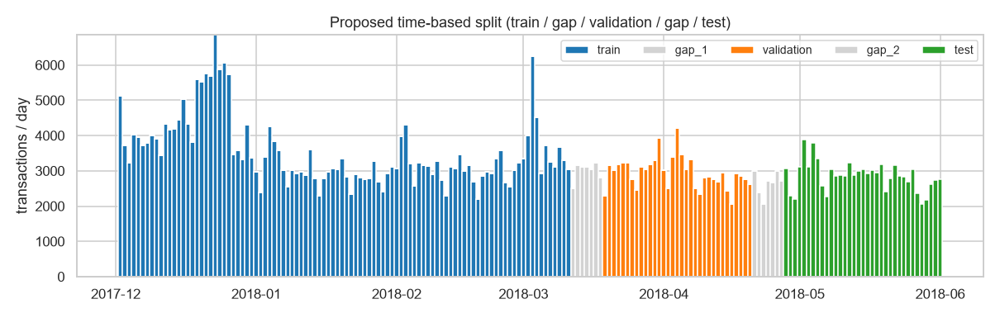

# EDA findings: IEEE-CIS Fraud Detection (Step L02)

Source: `ml/notebooks/01_eda.ipynb` (executed 2026-10-27) · figures in `reports/figures/eda/` ·
data: `data/processed/train.parquet` (labelled) and `test.parquet` (Kaggle test, no labels).

## Decision
**IEEE-CIS is confirmed as the project dataset.** The PaySim fallback is not needed. There is no
single-column leak, the data shows real drift over time, and there are enough readable or engineerable
signals to give analysts meaningful explanations.

## Key numbers
| Topic | Finding |
|---|---|
| Size | 590,540 labelled transactions × 434 raw columns (+ datetime); 931 MB in memory; loads in ~1 s |
| Period | 182 days, 2017-12-02 → 2018-06-01. Kaggle test: 2018-07-02 → 2018-12-31 (after a 30-day gap) |
| Fraud rate | **3.50%** (20,663), 1 : 27.6; 3.87% of the money ($3.08 M of $79.7 M) |
| Daily volume | median ~3,050 transactions and ~113 frauds per day (review capacity of 150/day is realistic) |
| Stability | weekly fraud rate 2.3% – 4.9%; lower in December (holidays) |
| Readability | ~415 of 434 features are masked (`V`, `id_`, `C`, `D`, `M`); only ~20 are directly readable |
| Missing values | 214 / 434 columns > 50% missing; identity data present for only 24.4% of rows |

## Signals (fraud rate vs 3.50% overall)
- **Strong, readable:** product C 11.7% (W 2.0%) · credit 6.7% (debit 2.4%) · mobile 10.2%, desktop 6.5%, no device data 2.1% · hours 6–9 (relative) up to 10.6% (busy hours ~2.3%) · payer outlook.com 9.5%, hotmail.com 5.3%, att.net 0.7% · recipient gmail.com 11.9%, outlook.com 16.5%.
- **Missingness is informative:** identity present 7.85% vs 2.09% · `addr1` missing 11.8% vs 2.5% · `R_emaildomain` present 8.2% vs 2.1%.
- **Weak:** raw amount (median $75 fraud vs $68.5 legit; heavy overlap) · whole-dollar amounts (3.59% vs 3.41%) · card network (except Discover 7.7%).
- **Surprise:** *same* payer/recipient e-mail domain is riskier (9.7%) than *different* (2.9%). This is the opposite of the "mismatch = risk" assumption, so the initial design assumption was revised.
- Best single numeric column: `C4`, ROC-AUC 0.69 (no column above 0.95).

## Proposed time split (to implement in L03)
| Period | Dates (inclusive) | Rows | Share | Fraud rate |
|---|---|---|---|---|
| train | 2017-12-02 → 2018-03-11 | 353,716 | 59.9% | 3.38% |
| gap 1 | 2018-03-12 → 2018-03-18 | 20,946 | 3.5% | 3.78% |
| validation | 2018-03-19 → 2018-04-20 | 97,344 | 16.5% | 3.93% |
| gap 2 | 2018-04-21 → 2018-04-27 | 18,549 | 3.1% | 3.44% |
| test | 2018-04-28 → 2018-06-01 | 99,985 | 16.9% | 3.43% |

Gap rows are not used for training or scoring. They may be used as *history* for behavioural features.

## Drift (PSI: < 0.1 stable, 0.1–0.25 moderate, > 0.25 significant)
| Feature | Dec 2017 → May 2018 | Train → Kaggle test | Meaning |
|---|---|---|---|
| `id_31` browser version | 1.35 | 0.94 | versions move on (chrome 63 → 70/71) |
| `D15` | 0.45 | 0.34 | "days since" values grow over time |
| `ProductCD` | 0.42 | 0.01 | holiday product mix in December |
| `DeviceInfo` | 0.30 | 0.02 | seasonal device mix |
| `V258` | 0.25 | 0.01 | seasonal |
| amount, card4/6, P_email, addr1, C1, dist1 | < 0.1 | < 0.01 | stable |

## Pseudo customer `uid = card1 + addr1 + (day − D1)`
- 199,070 uids; 58% have a single transaction; p99 = 19; max 1,414 (probably shared/default details).
- Consistent inside a uid: card network 100%, card type 99.8%, device type 96%, payer e-mail 73.9%. So a uid is a good approximation of a customer, not an exact one.
- 11.3% of rows have no uid (missing `addr1`/`D1`); these rows are riskier (~11.6% fraud).

## ⚠ Leakage findings
1. **Label propagation (confirmed):** after a fraud, the same uid's next transaction is fraud **87.2%** of the time (vs 0.36% after a legit one). 54.6% of uids with a fraud are fraud on every transaction.
2. **Entity overlap:** 39% of validation and 29% of test rows belong to uids seen in train. Only 1.0% / 0.7% belong to uids with a *fraud* in train, but those rows are 60.5% / 52.2% fraud, which is **~10% of all test frauds**.
3. No duplicate IDs. No single column predicts fraud suspiciously well.
4. Rare categories can be memorised (e.g. one `DeviceInfo` model: 83% fraud over 203 rows).

## Rules and implications for the next steps
**L03, features + split**
- Implement the split above. Keep NaN, and add `has_identity` and `has_uid` / `addr1_missing` flags.
- Prioritise readable engineered features: amount vs the card's own history, hour of day, product, card type, device type, e-mail domains (+ same-domain flag), 24 h velocity and novelty per uid, all computed **from past transactions only**.
- Normalise `D` columns as `day − D`. Use the browser *family*, not the `id_31` version. Frequency-encode high-cardinality columns and group rare values.
- **Forbidden:** past labels of the same uid/card as features (no "previous fraud", no target encoding by uid/card), and `uid` / `TransactionID` as raw features.

**L04–L05, evaluation**
- PR-AUC + recall at precision + precision@150/day; per-week metrics on test.
- Report test metrics **overall and excluding uids that had a fraud in train**. The second number is the honest one for new fraud.

**L12, monitoring demo**
- Use `id_31` (browser version) and `D15` as the clear drift examples; amount/card features as the stable baseline.
