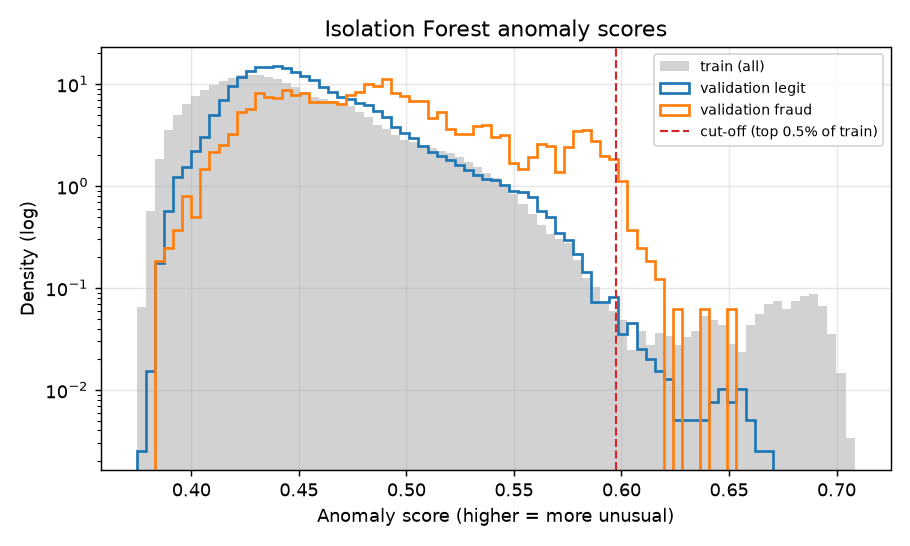

# Anomaly safety net (Isolation Forest): findings

**Detector:** `iforest-2026.10.27-1`, an Isolation Forest (200 trees) on the 59 curated features, fitted on the train period **without labels**. **Rule:** a transaction that the production model (`lgbm-2026.10.27-1`, expected loss ≥ $21.82) did not alert, but whose anomaly score is in the top 0.5% of train scores (cut-off 0.5976), is flagged as an "unusual pattern". The cut-off was fixed on train and not tuned. Generated numbers: [`anomaly_validation.md`](anomaly_validation.md), [`anomaly_test_results.md`](anomaly_test_results.md).

## Results

| | Validation | Test (checked once) |
|---|---|---|
| Rows above the cut-off | 0.14% | 0.15% |
| Extra alerts per day (mean / max) | 2.9 / 9 | 2.8 / 8 |
| Extra frauds caught | 9 | 1 |
| Precision of extra alerts (lift vs fraud rate) | 9.4% (2.4×) | 1.0% (0.3×) |
| Fraud $ caught: main → with safety net | 71.0% → 71.1% | 65.5% → 65.5% |
| Net savings change | +$117 | −$516 |
| Isolation Forest alone: PR-AUC | 0.124 | 0.074 |

## Conclusions

1. **The safety net adds almost nothing on this dataset.** The validation result passed the keep rule (lift > 2), but only narrowly: it rested on 9 frauds, so it was noise. On test the extra alerts are *less* precise than random review (1 fraud in 99 alerts).
2. **Most unusual transactions are already caught by the main model.** Among validation rows above the cut-off, 30% are fraud, but the expected-loss rule already flags most of them, often because they are large. Only about 3 alerts/day are left for the safety net.
3. **Unusual is not the same as fraudulent.** The Isolation Forest alone ranks fraud far worse than the supervised model (PR-AUC 0.07–0.12 vs 0.45–0.56). This matches the expectation in the project spec: anomaly detectors have low precision, and their value is coverage of unknown patterns.
4. **A one-off burst distorts the cut-off.** 967 train transactions from 11–15 December 2017 (product C, with extreme counter values such as `C1` ≈ 3,300 against a typical 1) hold about 0.27% of train and sit above the cut-off. So the "top 0.5%" cut-off flags only about 0.15% of later traffic. Refitting the cut-off on recent traffic belongs to monitoring and retraining.
5. **Sensitivity (validation, information only):** a 0.25% cut-off flags almost nothing. A 1% cut-off adds 20 alerts/day and 77 frauds (lift 2.9) but loses $1,225, because the extra frauds are small amounts.

## Decision

The rule is **kept only as a low-priority "unusual pattern" flag** (the plan's fallback). It costs about 3 alerts/day and is reviewed only when capacity is left after the main alerts. It is never counted as a model alert, and its effect is reported as above, not as extra savings. The detector artifact is saved for the scoring API. The scoring API must use the same scikit-learn version (1.9.x), which is recorded in its metadata.

