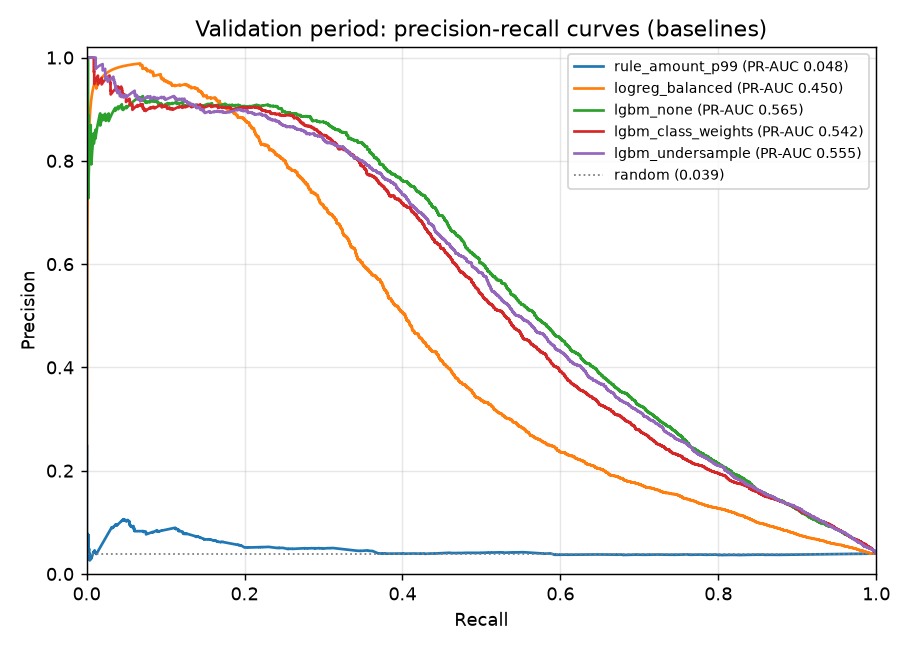

# Baselines and imbalance strategies: findings

Validation period (2018-03-19 → 2018-04-20, 97,344 transactions, 3.93% fraud, 33 days). All models were trained on the train period only. The test period was not read. Full numbers: [`baselines_comparison.md`](baselines_comparison.md) (generated). Costs: $5 per review, $2 friction per false alarm, a missed fraud costs its amount, capacity 150 alerts/day.

## Results (overall population)

| Model | PR-AUC | 95% CI (day bootstrap) | Precision in daily top 150 | Fraud $ caught at threshold | Net savings vs no model |
|---|---|---|---|---|---|
| Rule: amount > train p99 ($1,092) | 0.048 | 0.044–0.053 | 0.084 | 12.3% | $73k |
| Logistic regression (balanced) | 0.450 | 0.411–0.496 | 0.369 | 38.7% | $223k |
| **LightGBM, no resampling** | **0.565** | 0.529–0.603 | **0.453** | 57.9% | $349k |
| LightGBM, class weights (28.5) | 0.542 | 0.504–0.577 | 0.428 | 54.1% | $325k |
| LightGBM, undersampling 1:5 (corrected) | 0.555 | 0.519–0.590 | 0.444 | 58.4% | $352k |

Without a model, validation fraud would cost $654k. Excluding customers who already had a fraud in train changes little for LightGBM (PR-AUC 0.564 / 0.556 / 0.564), so the model does not depend on those repeat customers.

## Conclusions

1. **LightGBM beats the baselines by a wide margin.** It scores +0.115 PR-AUC over logistic regression (bootstrap difference interval entirely below 0) and saves about $125k more on validation.
2. **No resampling works best on ranking.** Class weights are clearly worse: −0.025 PR-AUC, interval [−0.035, −0.016]. They also inflate probabilities (Brier 0.077 vs 0.024). Undersampling is slightly worse: −0.011, interval [−0.021, −0.001]. Two other random draws scored 0.547 and 0.550. Its small savings lead ($352k vs $349k, under 1%) is within noise.
3. **The probability correction works.** After undersampling, the corrected mean probability is 3.59%, against a 3.93% validation fraud rate.
4. **Capacity is the binding constraint.** Every model's cost-optimal threshold uses the full 150/day budget (148/day on average). Without the cap, cost keeps falling until about 500 alerts/day. More review capacity would pay off, which is a useful business message for the defense ([cost curve](figures/baselines_cost_curve.png)).
5. **A fixed threshold overflows on peak days.** Average alerts stay at 148/day, but single days reach 215–241. The review queue must handle the overflow.
6. **Amount matters for dollar metrics.** Ranking by amount alone catches 51% of fraud *value* in the daily top 150, more than logistic regression (40%) and close to LightGBM (56%). The model step should test ranking alerts by expected loss (calibrated probability × amount).

## Decision for the model step

Tune **LightGBM on all training rows without class weights or resampling**, then calibrate (isotonic, on validation) and choose the cost-optimal threshold. Undersampling stays available as a speed option for Optuna trials (5× fewer rows, 2.5× faster training) if tuning time becomes a problem.

