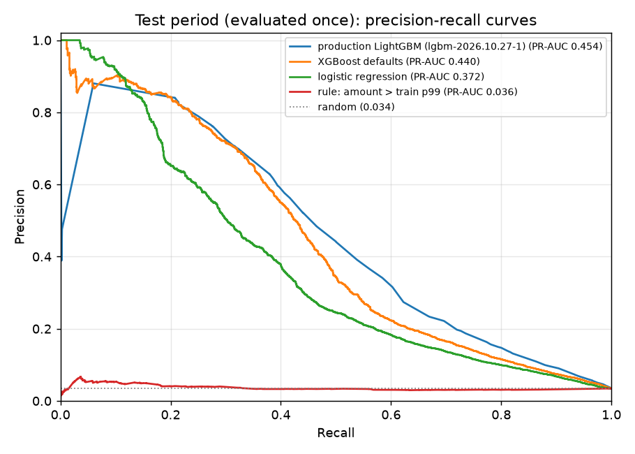

# Production model, calibration, alert policy and test results: findings

Production model: **`lgbm-2026.10.27-1`**. It is LightGBM with default settings (500 trees, learning rate 0.05) on the 59 curated features, trained on the train period (2017-12-02 → 2018-03-11). Isotonic calibration and the alert threshold were fitted on the validation period (2018-03-19 → 2018-04-20). The test period (2018-04-28 → 2018-06-01) was evaluated **once**. Generated numbers: [`model_validation.md`](model_validation.md), [`test_results.md`](test_results.md).

## 1. Tuning was rejected: its gain came from known fraudsters

Optuna ran 30 trials on 3 time-ordered folds inside the train period. Its CV PR-AUC was 0.606, against 0.591 for the defaults. On validation, though, the gain did not hold up:

| | PR-AUC overall | PR-AUC excluding customers with a fraud in train |
|---|---|---|
| Defaults | 0.565 | **0.564** |
| Tuned (195 leaves) | 0.574 | 0.548 |
| Difference (day bootstrap, 95% CI) | +0.009 [−0.002, +0.019] | **−0.015 [−0.026, −0.005]** |

The tuned model puts 62.5% of the frauds by customers already caught in train into its top 5% (defaults: 51.9%). For all other frauds it does slightly worse (59.8% vs 60.5%). Larger trees re-identify customers through customer-like features (`D1n`, card/region frequencies), which is an indirect form of label propagation. **Decision: keep the defaults.** This is a negative result worth presenting: a higher headline score can hide leakage.

## 2. Other comparisons (validation)

- **XGBoost with default settings** (GPU, 2 s): PR-AUC 0.529, below LightGBM (0.565).
- **Curated vs full features** (59 vs 409 columns, defaults): PR-AUC 0.565 vs 0.595 (excluding repeat-fraud customers: 0.564 vs 0.609), but net savings $349k vs $343k. The readable feature set costs some ranking quality and almost nothing in money.

## 3. Calibration and alert policy (validation)

- The model was trained without resampling and is already well calibrated: Brier 0.0238 → 0.0236 after isotonic calibration, and the mean probability equals the fraud rate. Isotonic calibration merges scores into steps (26 distinct values in the top 5%), so PR-AUC dips slightly (0.565 → 0.559).
- **Alert policy B, expected loss = probability × amount ≥ $21.82, beats policy A (probability ≥ t).** Net savings are $434k vs $342k and fraud $ caught is 71% vs 56.5%, at the same 148 alerts/day. Its precision is lower (0.37 vs 0.48): analysts see more false alarms, but on larger amounts. This follows directly from the cost model, where a missed fraud costs its amount.

## 4. Test period (evaluated once)

| Metric | Validation | **Test** |
|---|---|---|
| PR-AUC (calibrated probability) | 0.559 | **0.454** |
| … excluding customers with a fraud in train | 0.558 | **0.455** |
| Alerts per day (mean / max) | 148 / 242 | **153 / 210** |
| Precision of alerts | 0.370 | **0.250** |
| Fraud $ caught | 71.0% | **65.5%** |
| Net savings vs no model | $434k of $654k | **$303k of $516k (59%)** |

- **The target is met:** 65.5% of fraud value is caught within capacity (target ≥ 50%).
- **The ranking of models holds on test** (threshold-free): LightGBM 0.454 > XGBoost 0.440 > logistic regression 0.372 > amount rule 0.036.
- **The model does not rely on repeat fraudsters:** excluding them gives the same PR-AUC (0.455).
- **Drift:** PR-AUC drops from 0.559 to 0.454. The test weeks are 7–12 weeks after the end of training, and the EDA showed drifting features. Probabilities are slightly too high on test (mean 4.2% vs a 3.4% fraud rate), and alert volume overshoots a little (153/day). This motivates drift monitoring and the retraining script.
- **Weekly stability:** fraud $ caught is 62–70% every week, and net savings cover 54–65% of the weekly fraud loss. There is no downward trend over the 5 test weeks ([figure](figures/test_weekly.png)).

## Consequences for later steps
- **Explanations (SHAP):** explain the raw LightGBM output of `model.txt`; show the calibrated probability and the expected loss next to it.
- **Scoring API:** register `artifacts/models/lgbm-2026.10.27-1/` in `model_versions`. The score is calibrated p; the alert rule is p × amount ≥ $21.82.
- **Review queue:** order the queue by expected loss and cap it at 150/day. The fixed threshold yields 210–242 alerts on peak days.
- **Monitoring and retraining:** probability drift is visible on test, so the monitoring and retraining workflow is justified.

